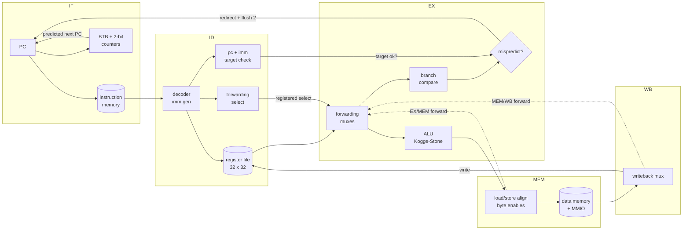
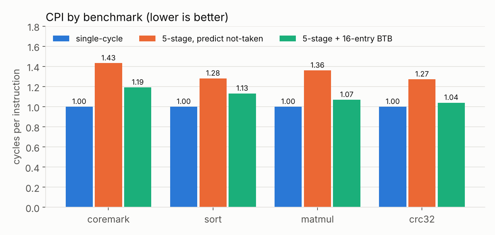
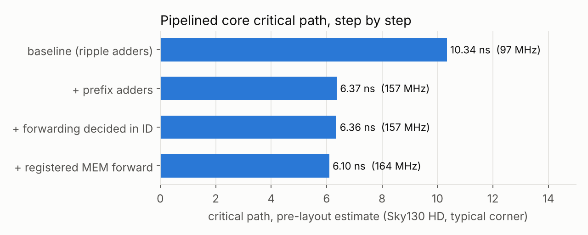

# riscv-cpu

A 5-stage pipelined RV32I processor in SystemVerilog, with a branch predictor, a bare-metal C
runtime and a CoreMark port, verified instruction by instruction against my own C++ golden
model, and taken toward silicon in the open SkyWater 130nm process.

<!-- demo GIF goes here: docs/demo.gif (see docs/GUIDE.md, "Recording the demo") -->

## Headline numbers

| | |
|---|---|
| ISA compliance | **40/40** official `rv32ui` tests on all three cores (single-cycle, pipelined, pipelined + BTB) |
| Verification | every retired instruction checked against a C++ golden model; 400 random programs; **19/19** injected bugs caught by mutation testing; 1.57 M RTL unit-test checks |
| CoreMark | **1.12 CoreMark/MHz** with the branch predictor (0.93 without), CRC-validated, simulation |
| Branch prediction | 16-entry BTB + 2-bit counters: **73%** of CoreMark branches predicted, flush cycles 28% → 14%, CPI 1.43 → 1.19 |
| Critical path | **10.3 ns → 6.1 ns** (97 → 164 MHz) with Kogge-Stone adders and registered forwarding, pre-layout, Sky130 HD typical corner |
| Area (pre-layout) | 8,027 cells / 0.080 mm² (pipelined core); 0.111 mm² with the BTB |

Chip layout: the LibreLane (OpenLane 2) flow is set up in `flow/`; post-layout clock, area and
power come from `python3 scripts/flow.py run` (see [Chip layout](#chip-layout)).

## Architecture



| Stage | Work | Key hardware |
|---|---|---|
| IF | fetch at PC; next PC from the BTB (hit and predicted taken) or PC + 4 | PC, branch target buffer |
| ID | decode, read registers, immediate; compute branch target and forwarding selects early | decoder, register file (WB→ID bypass), prefix adder |
| EX | forwarding muxes, ALU, branch compare, JALR target; check the prediction, trap detection | ALU and comparator on Kogge-Stone adders |
| MEM | loads and stores (LB/LH/LBU/LHU sign handling, SB/SH byte enables), MMIO | load/store unit |
| WB | write the register file, report the retired instruction | |

**Hazards** (`rtl/hazard_unit.sv`), the part interviewers ask about:

- **Forwarding**: EX/MEM → EX and MEM/WB → EX for both operands (and store data). The register
  file writes before it reads, covering distance 3. The forwarding *decision* is made a stage
  early, in ID, and registered, so EX only sees a ready-made mux select.
- **Load-use**: a load followed by a dependent instruction inserts one bubble; the value then
  comes from MEM/WB.
- **Control**: branches and jumps resolve in EX. The prediction made in IF (BTB, or not-taken)
  is checked there; a wrong direction or target flushes the two younger instructions.
- **Traps**: ECALL/EBREAK halt (tests and programs end that way); illegal instructions and
  misaligned loads, stores or jump targets halt with a cause, with no side effects.

Memory map: instruction ROM `0x0000_0000`, data RAM `0x1000_0000`, UART `0x2000_0000`, LEDs
`0x2000_0010`, cycle / instret / stall / flush / branch counters `0x2000_0020-0x38`.

## Verification

| Layer | What | Result |
|---|---|---|
| Unit | ALU, immediate generator, branch unit, register file, hazard unit vs C++ reference models; edge values + random | 1,571,937 checks pass |
| Compliance | official [riscv-tests](https://github.com/riscv-software-src/riscv-tests) `rv32ui` with a bare-metal test environment | 40/40 on all 3 cores |
| Golden model | every retired instruction (PC, instruction, register write, memory access, trap) compared in lockstep with `sim/iss.cpp`, my independent C++ ISA simulator, which itself passes the same 40 tests standalone | any mismatch fails the run |
| Directed hazards | hand-written assembly for every forwarding path, load-use cases, store data, back-to-back branches, JALR, x0, and BTB aliasing | pass |
| Random | 400 generated programs biased toward dependencies, loads/stores, branches and counted loops | 246,799 instructions, all match |
| Mutation | 19 realistic bugs injected one at a time (drop a forwarding path, skip the load-use stall, lose a carry, ...) | 19/19 caught |

Two holes found and closed this way: the official suite never jumps through JALR to an odd
address (so "forgot to clear bit 0" passed it), and nothing tested two branches aliasing in
the BTB. `sw/tests/hazards/` covers both.

`fence_i` (needs self-modifying code, impossible with a separate instruction ROM) and `ma_data`
(needs a trap handler; CSRs are out of scope) are the two rv32ui tests not run.

## Performance



| Benchmark | Single-cycle CPI | Pipelined CPI | + BTB CPI | Flush cycles (no BTB → BTB) | Prediction |
|---|---|---|---|---|---|
| CoreMark | 1.000 | 1.433 | 1.192 | 28.3% → 13.8% | 73.1% |
| quicksort, 2,048 ints | 1.000 | 1.281 | 1.131 | 21.9% → 11.6% | 71.5% |
| matrix multiply 24×24 | 1.000 | 1.360 | 1.069 | 26.5% → 6.4% | 89.6% |
| CRC-32, 4 KB | 1.000 | 1.273 | 1.040 | 20.5% → 2.7% | 90.4% |

Load-use stalls cost only ~2% of cycles; control hazards dominate, which is what motivated the
branch predictor. Every benchmark checks its own result, and every run is golden-model checked.

**BTB size** (`scripts/btb_sweep.py`): CoreMark CPI 1.205 / 1.180 / 1.174 / 1.172 for 8 / 16 /
32 / 64 entries. 16 entries gets nearly all of the benefit; a 64-entry BTB made of flip-flops
would more than double the core's area (0.080 → 0.191 mm²). JALR targets are not predicted:
that removes a 32-bit compare from the EX critical path for a 1% CPI cost.

### Critical path



Measured with Yosys + ABC against the Sky130 HD liberty (`scripts/timing_ladder.py`; every
earlier step is rebuilt from the current RTL so all four use identical tool settings):

| Step | Critical path | Clock | What changed |
|---|---|---|---|
| 1. Baseline | 10.34 ns | 97 MHz | ripple-carry adders: 29 majority gates in series from `ex_pc` to the next PC |
| 2. Kogge-Stone adders | 6.37 ns | 157 MHz | ALU, branch comparator and target adder carry in log₂32 = 5 levels |
| 3. Forwarding decided in ID | 6.36 ns | 157 MHz | register-number comparators moved out of EX (no gain once the target adder also moved to ID) |
| 4. Registered MEM forward | 6.10 ns | 164 MHz | the value MEM forwards is selected at the end of EX, so forwarding starts at a flop |

These are pre-layout estimates (no wires, typical corner) and ABC's results move ±10% with
small structural changes, so trust the trend. The post-layout number comes from the flow.

### Single-cycle vs pipelined

Performance is clock period × CPI. With ideal zero-delay memories, the single-cycle core
synthesizes to 7.42 ns: its path is long, but it has no forwarding or flush logic. Real memory
changes the picture. A memory access of *t* ns lands twice in the single-cycle core's path
(fetch, then load/store) but only once in a pipeline stage (plus ~1.06 ns of load alignment
in MEM):

| Memory access time | Single-cycle (ns/instr) | Pipelined | Pipelined + BTB | Speedup with BTB |
|---|---|---|---|---|
| 0 ns (ideal) | 7.42 | 8.74 | 7.38 | 1.01× |
| 1 ns | 9.42 | 8.74 | 7.38 | 1.28× |
| 2 ns | 11.42 | 8.74 | 7.38 | 1.55× |
| 3 ns | 13.42 | 8.74 | 7.38 | 1.82× |

(CoreMark CPI; single-cycle period 7.42 + 2t, pipelined max(stage, t + 1.06).) Without branch
prediction the pipeline only pays off once memory is slower than ~1 ns.

## Chip layout

`flow/config.json` takes `rtl/synth/chip_top.sv` (the pipelined core with its 16-entry BTB,
memories as external ports) through LibreLane, the successor to OpenLane 2: Yosys synthesis,
OpenROAD floorplan, placement, clock tree, routing, static timing at every corner, DRC and LVS,
to a GDSII layout in SkyWater 130nm.

```bash
python3 scripts/flow.py run                      # inside LibreLane's nix-shell; ~20-40 min
python3 scripts/flow.py run --variant baseline   # the "before": ripple adders etc.
python3 scripts/flow.py layout                   # open the GDS in KLayout
```

`flow.py` writes `docs/results/flow_<variant>.json`: worst setup slack → achieved clock, cell
count, area, utilization, power. Setup instructions are in [docs/GUIDE.md](docs/GUIDE.md).

<!-- layout screenshot goes here: docs/layout.png -->

## Running it

Needs Verilator ≥ 5, a `riscv64-unknown-elf-gcc` and Python 3
(`sudo apt install verilator gcc-riscv64-unknown-elf`, or Homebrew on macOS).

```bash
git clone --recursive https://github.com/<you>/riscv-cpu && cd riscv-cpu
make test                              # build 3 simulators, run rv32ui + hazard tests
make unit                              # RTL unit tests
make run PROG=hello CORE=pipe_bp       # C program printing over the simulated UART
make run PROG=coremark CORE=pipe_bp
python3 scripts/random_test.py         # random programs vs the golden model
python3 scripts/mutation_test.py       # inject bugs, confirm the tests catch them
python3 scripts/bench.py               # CPI / hazard table
```

Simulator options: `--vcd wave.vcd` (open in GTKWave), `--trace commits.txt` (one line per
retired instruction), `--no-check` (skip the golden model).

| Path | Contents |
|---|---|
| `rtl/` | `core_pipe.sv`, `core_single.sv`, `hazard_unit.sv`, `branch_predictor.sv`, `prefix_adder.sv`, `alu.sv`, `decoder.sv`, `lsu.sv`, `regfile.sv`, `soc.sv` |
| `tb/` | Verilator testbench with lockstep golden-model checking; unit-test harness |
| `sim/` | `iss.cpp`: the C++ golden model; `rv32sim` runs it standalone |
| `sw/` | `crt0.S`, linker script, printf/counter library, programs, CoreMark port, test environment, hazard tests |
| `scripts/` | test runners, random and mutation testing, benchmarks, synthesis estimates, layout flow |
| `flow/` | LibreLane configuration |

## What I learned

- **Measure before optimizing, then check the measurement.** The first critical-path numbers
  moved by 10% with no logic change: ABC was optimizing for area once a loose delay target was
  met, and Yosys had re-encoded a pipeline register as a state machine. Delay-driven mapping,
  `-nofsm`, and rebuilding every design point under the same settings made the ladder trustworthy.
- **The textbook pipeline barely beats single-cycle.** With ideal memories the pipelined core's
  CPI of 1.43 almost cancels its faster clock. The hardware counters showed 28% of cycles lost
  to flushes, and the branch predictor recovered most of it. Pipelining pays off because real
  memory is slow, and only once control hazards are handled.
- **Passing the official tests isn't enough.** Mutation testing showed the rv32ui suite never
  exercises JALR's bit-0 clearing, and that a BTB target-check bug is invisible unless two
  branches alias exactly. Both got directed tests.
- **A predictor can't break correctness, only speed**, as long as every prediction is checked.
  A "no tag check" bug made the predictor worse but passed every test, which is right: that
  belongs in a benchmark, not a test.
- **Portability matters for hardware.** Yosys 0.33 can't parse SystemVerilog package imports or
  2-D packed arrays, so constants live in an include file and the prefix tree in flat vectors.
